 # ClassPose × HTAN CRC: Work to Date
### Meeting — March 2026

---

## The HTAN HMS CRC cohort is a well-characterised real-world dataset

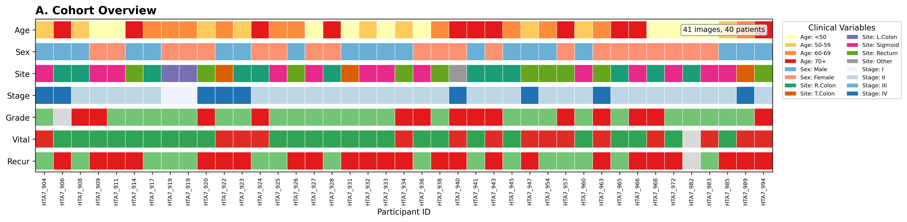

- 40 patients with colorectal adenocarcinoma, AJCC stage I–IV, from the Harvard Medical School HTAN atlas
- H&E whole-slide images acquired on the **Orion platform** — the same tissue sections have matched multiplexed immunofluorescence (mIF) data
- Targeted sequencing available for 11 CRC driver genes across all patients
- One patient (HTA7_919) contributed two near-serial sections, enabling technical reproducibility assessment
- Clinical endpoints available: overall survival, cancer-specific survival, progression-free survival

---

## nf-classpose ran both models across all 41 slides on AWS Batch

- Built a Nextflow wrapper around ClassPose to handle WSI ingestion, tiling, GPU inference, and output aggregation
- Input images fetched from CRDC/Gen3 via DRS; outputs written to S3 in both CSV and SpatialData zarr format
- Pipeline executed on AWS Batch via Seqera Platform (run date: 27 January 2026; 3 attempts, final resumed from cache)
- **164 tasks total:** 41 GEN3_DOWNLOAD + 41 VIPS_CONVERT + 82 CLASSPOSE_PREDICT_WSI (41 slides × 2 models)
- ClassPose GPU tasks: ~1–4 h wall time per slide, peak RAM ~40–45 GB; run to completion without manual intervention
- Source: **github.com/adamjtaylor/nf-classpose**

---

## Each slide takes ~1.5 h of GPU compute; ConSeP is consistently slower than CoNIC

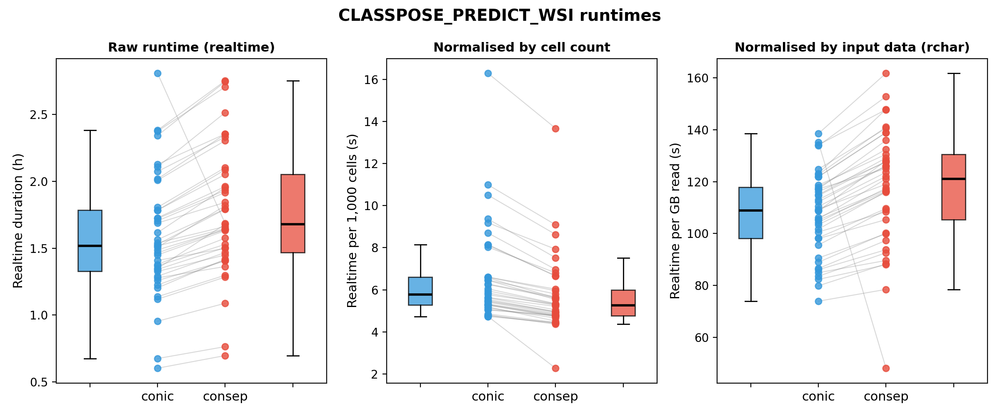

- Realtime GPU execution (scheduling excluded) across 41 slides × 2 models = 82 tasks
- **CoNIC median: 1.52 h; ConSeP median: 1.68 h** — ConSeP is ~10% slower in absolute terms
- Normalised by cell count: CoNIC is actually slower *per cell* — ConSeP detects more cells per unit compute
- Normalised by data read: ConSeP consistently uses more compute per GB of image data, regardless of slide size
- Paired design (lines connect the same slide) removes slide-size variation and makes the model difference clear
- Total GPU cost for the full cohort: ~130 h realtime across both models

---

## ClassPose assigns cell-level classifications directly from H&E morphology

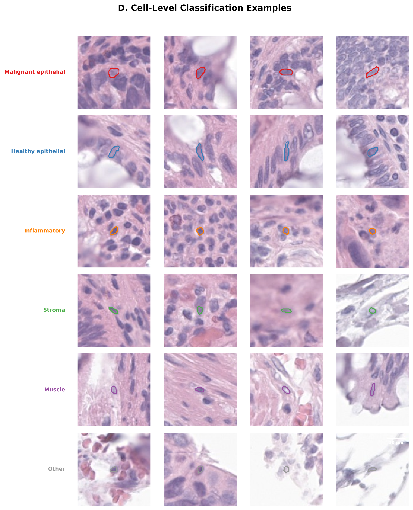

- Each panel shows a high-magnification crop with a single classified cell outlined in its class colour
- Six ConSeP classes distinguished by morphological features alone: nuclear size, shape, chromatin pattern, and cytoplasmic context
- Malignant epithelial cells show enlarged, irregular nuclei with prominent nucleoli; inflammatory cells show the dense, round nuclei of lymphoid infiltrate
- The "Inflammatory" class encompasses the full immune infiltrate without subtype resolution — CoNIC provides that (lymphocyte, plasma cell, neutrophil, eosinophil)

---

## ConSeP and CoNIC together classify nearly 90 million cells across the cohort

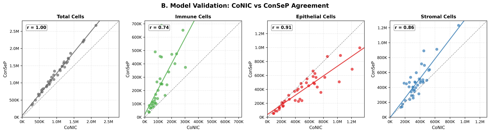

- **ConSeP: 50,191,395 cells** (6 classes: malignant epithelial, healthy epithelial, stroma, muscle, inflammatory, other)
- **CoNIC: 39,283,683 cells** (6 classes: epithelial, connective, lymphocyte, plasma cell, neutrophil, eosinophil)
- Cross-model concordance: immune r=0.73, epithelial r=0.90, stromal r=0.82 (all p < 10⁻⁷)
- Running both models is informative: ConSeP distinguishes malignant from healthy epithelium; CoNIC resolves immune subtypes
- The difference in total cell count reflects model-level detection differences, not a data quality issue

---

## Near-serial sections confirm that cell classifications are technically reproducible

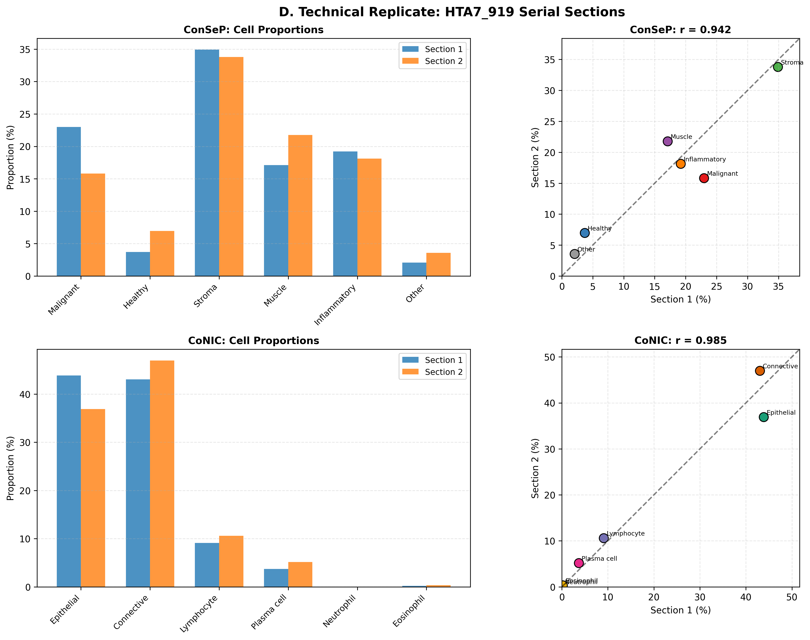

- HTA7_919 contributed two H&E images from near-serial tissue sections — the closest available approximation to a technical replicate
- Inflammatory % differs by only 1.1 percentage points between sections (19.2% vs 18.1%)
- Stromal proportions show similarly strong concordance (34.9% vs 33.8%)
- Greater variation in malignant epithelial % (23.0% vs 15.8%) likely reflects true within-tumour spatial heterogeneity, not classification noise
- Establishes that inter-slide differences in the cohort reflect biology, not technical artefact

---

## The spatial cell type mosaic captures the full diversity of CRC tissue architecture

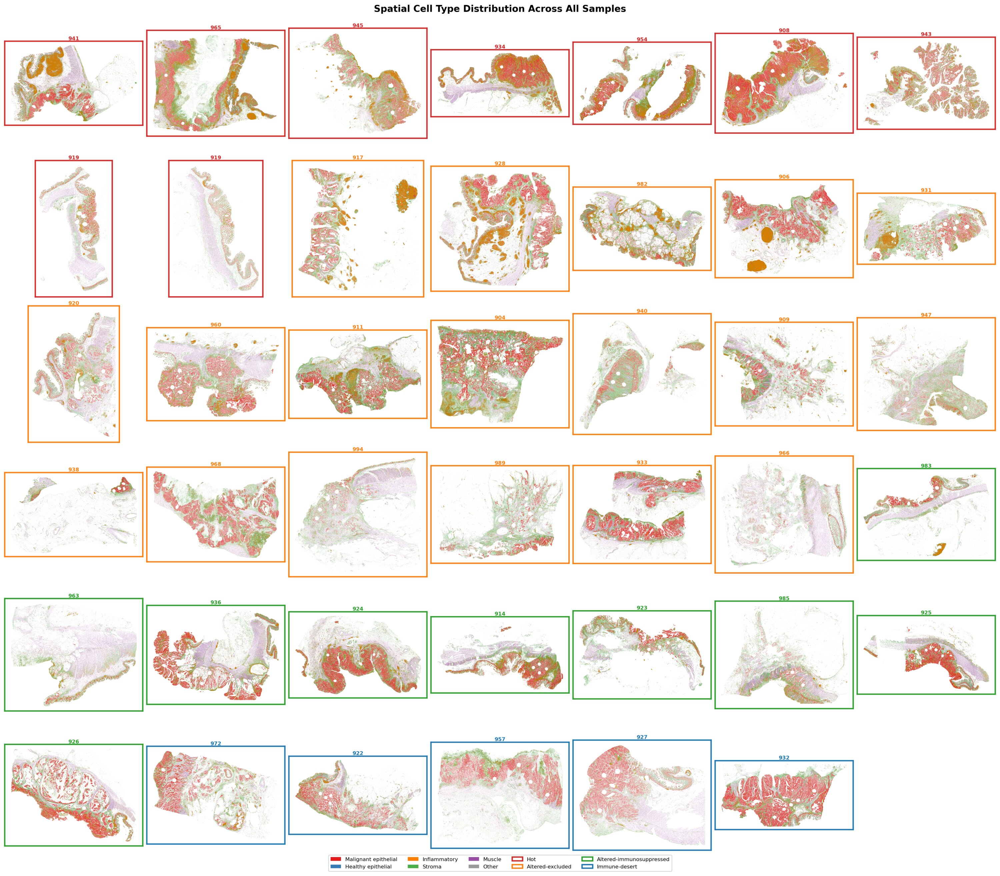

- Each panel shows all cell centroids for one sample, coloured by ConSeP class; border colour indicates immune phenotype
- The diversity of tissue architecture across the cohort is immediately apparent — dense mucosal tumours to dispersed patterns
- Spatial organisation of immune (orange) relative to tumour (red) cells differs markedly between phenotype groups even by eye
- This figure illustrates the scale of the data: tens of millions of individually classified cells, each with a spatial coordinate

---

## CRC tumours show striking heterogeneity in immune microenvironment composition

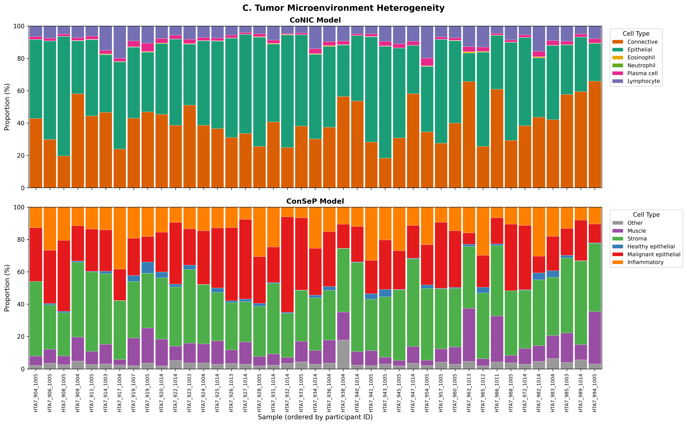

- Inflammatory cell percentage ranges from <5% to >40% across the cohort — a near 10-fold variation from slide to slide
- Hierarchical clustering of CLR-transformed proportions reveals distinct TME subtypes, not a continuous spectrum
- Tumour/stroma balance also varies dramatically, suggesting co-varying microenvironmental programmes
- Heterogeneity is the biological signal, not noise: it is this variation that drives the survival associations downstream

---

## Spatial analysis of cell positions classifies tumours into four immune phenotypes

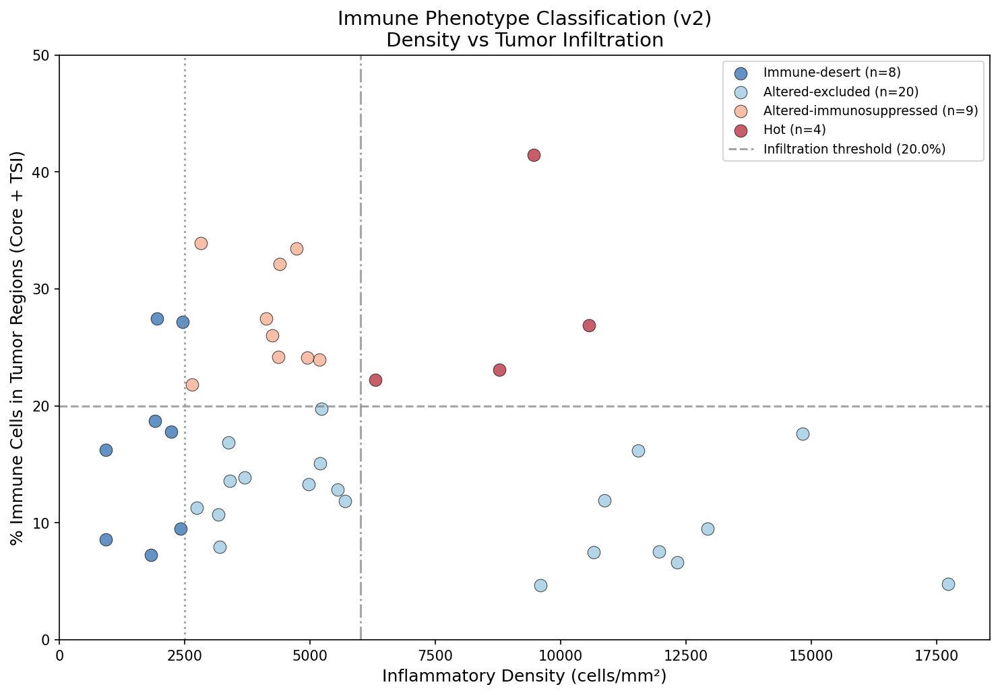

- Two-axis classification: overall inflammatory content (x) × tumour infiltration ratio (y)
- Infiltration ratio = density of immune cells in tumour core / density in stroma — distinguishes excluded from truly infiltrated
- **Hot** (22%): high inflammation, high infiltration — candidate immunotherapy responders
- **Altered-excluded** (44%): inflammatory cells present but physically excluded from tumour core
- **Altered-immunosuppressed** (22%): infiltration present but insufficient inflammatory load
- **Immune-desert** (12%): sparse immune presence throughout

---

## Spatial maps confirm that immune phenotypes reflect genuine tissue-level organisation

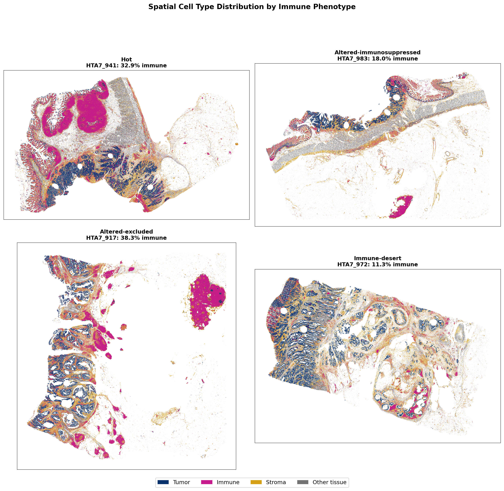

- Individual cell centroids plotted for representative samples of each phenotype (magenta = immune, dark blue = tumour, mustard = stroma)
- "Altered-excluded" pattern is visually striking: dense immune cells at the tumour periphery with a clear exclusion boundary
- "Hot" tumours show intermixing of immune and tumour cells at the single-cell level
- Classification from H&E morphology alone recapitulates the four-phenotype framework established by mIF-based studies

---

## Inflammatory cell density from H&E independently predicts progression-free survival

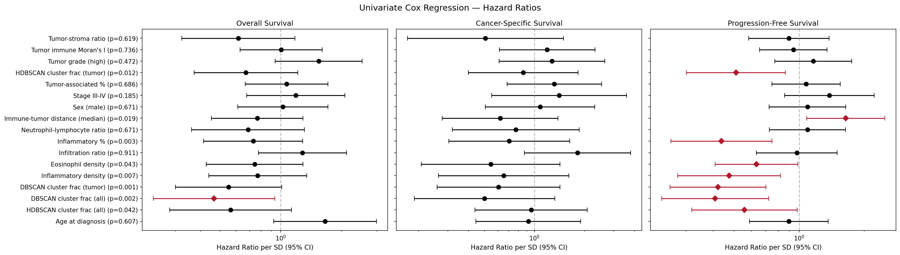

- Univariate Cox regression across 9 spatial features against OS, CSS, and PFS (n=39 evaluable patients)
- **Inflammatory % is the strongest predictor of PFS: HR = 0.44 per SD, p = 0.003**
- Eosinophil density (CoNIC-specific) adds independent signal not captured by ConSeP alone: HR = 0.63, p = 0.043
- Associations remain significant after adjustment for AJCC stage
- Infiltration ratio trends toward worse CSS (HR = 1.82, p = 0.111) — possibly reflecting immunosuppressive infiltration

---

## KRAS mutation status gates the prognostic benefit of tumour-proximal immune clustering

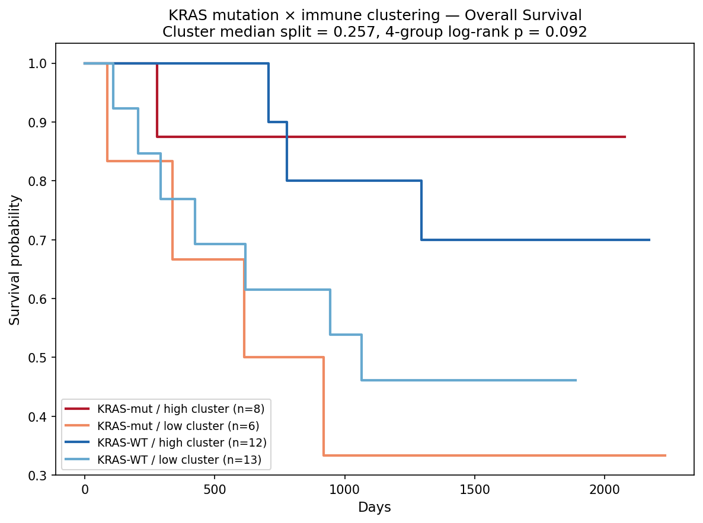

- Formal Cox interaction test: KRAS × tumour-proximal immune clustering, interaction p = 0.032
- **KRAS-mutant patients with high clustering: HR = 0.10 (90% hazard reduction, p = 0.03)**
- KRAS wild-type patients show no clustering benefit (HR = 0.76, p = 0.40)
- Effect survives exclusion of BRAF-mutant / likely MSI-H patients (interaction p = 0.020)
- KRAS-mutant MSS CRC is the largest molecularly-defined subgroup with no approved targeted therapy

---

## mIF marker intensities confirm that H&E-derived cell classes are biologically valid

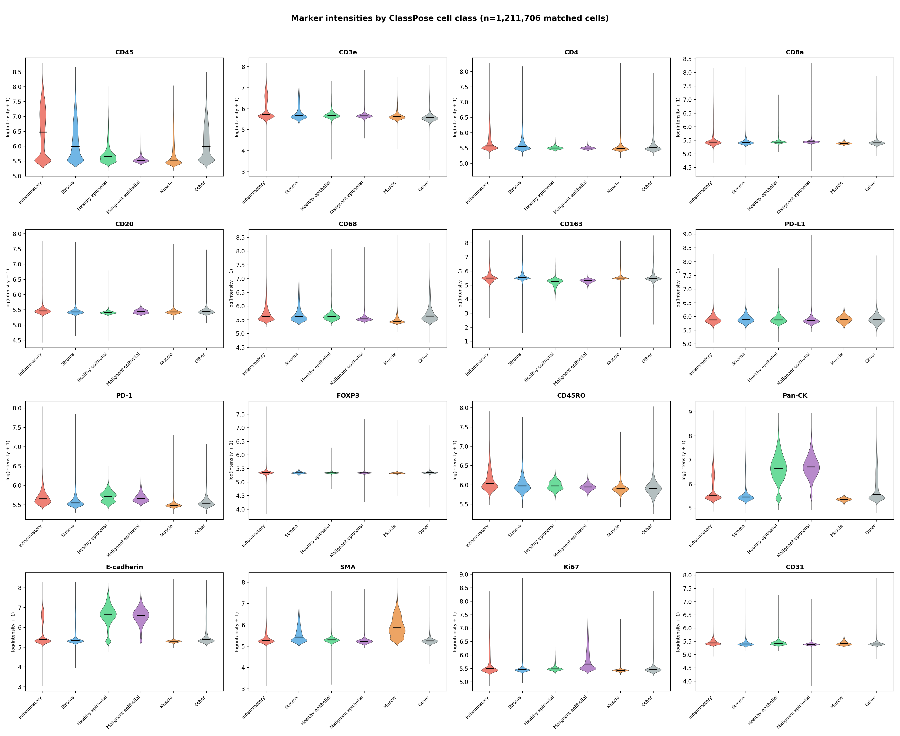

- 1,211,706 ClassPose-classified cells matched to their Orion mIF marker intensities by centroid proximity
- **CD45** enriched in Inflammatory; **Pan-CK** enriched in epithelial classes — expected immune and epithelial markers align
- **E-cadherin** highest in Healthy epithelial, consistent with loss of adhesion in malignant transformation
- **SMA** enriched in Muscle; **CD68** shows modest Inflammatory enrichment consistent with macrophage presence
- Cross-modal validation is only possible because the Orion platform images the same section with both H&E and mIF — a unique asset for model validation and fine-tuning

---

## Beyond Orion: other HTAN H&E + multiplexed imaging adjacent section pairs

Outside of the same-section Orion data at HMS, two HTAN atlas centres have H&E slides with formally recorded adjacent biospecimen IDs pointing to multiplexed imaging — identified by querying `Adjacent_Biospecimen_IDs` in the HTAN BigQuery biospecimen table.

| Atlas | Cancer type | H&E slides | Adjacent assay | Notes |
|---|---|---|---|---|
| **HTAN TNP SARDANA** | Colorectal (cecal mucous adenocarcinoma) | 22 | t-CyCIF | 1 file/pair; same tissue block, serial section |
| **HTAN TNP SARDANA** | Colorectal (cecal mucous adenocarcinoma) | 4 | CyCIF | 22–28 files/pair |
| **HTAN TNP SARDANA** | Colorectal (cecal mucous adenocarcinoma) | 2 | mIHC | 16 files/pair |
| **HTAN HTAPP** | Breast DCIS | 1 | MERFISH | 127 files; spatial transcriptomics, not protein |

**What this means for validation**
- **TNP SARDANA** is the strongest candidate: 22+ CRC slides with t-CyCIF/CyCIF protein imaging on adjacent sections — directly comparable to the Orion approach used here
- t-CyCIF and CyCIF provide marker-defined cell type calls (CD45, PanCK, etc.) that can serve as ground truth for ClassPose predictions on the H&E
- mIHC on 2 slides provides a lower-throughput but standard-of-care validation reference
- **HTAPP MERFISH** is transcriptomic, not proteomic — useful for cell type identification but different modality
- Together with HMS Orion (same-section, gold standard) and TNP SARDANA (adjacent-section, CRC), there is a multi-site validation corpus for CRC already within HTAN

**Caveat**: adjacency is only as close as the sectioning — true co-registration is not guaranteed; cell-level matching will require centroid-distance approaches as used here

---

## Longer-term: a pan-cancer ClassPose model trained and validated on HTAN

**The architecture opportunity**
- ClassPose works by attaching a classification attention head to the Cellpose segmentation backbone
- CoNIC and ConSeP are the two existing models — both trained on colorectal cancer tissue
- The same approach could yield a **pan-cancer model**: a new attention head trained across cancer types, generalising tumour / immune / stroma classification beyond CRC
- This is a natural next model in the ClassPose family, not a change of architecture

**The data HTAN provides**
- **2,503 H&E whole-slide images** across 9 atlas centres — open-access via Synapse
- Breast DCIS (n≈1,000), Lung (n≈960), CRC (n≈160), Pancreas (n≈72), Ovarian (n≈44), Melanoma (n≈30)
- Sites with matched mIF (HMS Orion, HTAPP CODEX) provide marker-defined ground truth labels for training and calibration
- nf-classpose already handles ingestion and inference at scale — running a new model head across all 2,503 slides is straightforward once the model exists

**The collaboration ask**
- Work with the ClassPose team to scope training data requirements and label schema for a pan-cancer head
- HTAN HMS contributes the mIF-validated CRC labels already in hand; broader HTAN atlas centres contribute label diversity
- Deliverable: **nf-classpose + pan-cancer head** as a community resource — reproducible TME profiling across the full HTAN H&E corpus
- Natural fit for a joint funding application with the ClassPose developers

---

## The right next step is a focused paper and a funded mIF validation project

**This work, publishable now:**
- nf-classpose pipeline as a community methods contribution
- HTAN CRC cohort as the demonstration dataset (41 slides, ~90M cells, n=40 patients)
- Survival and KRAS interaction results as the biological findings
- Target: short communication, *npj Precision Oncology* or *Cancer Research Communications*

**The follow-on, requiring funding:**
- Matched mIF images already in hand; panel metadata available
- mIF-derived cell type calls (from HMS or re-called from marker panel) → rigorous validation of ClassPose against marker-defined ground truth
- Validated calls → fine-tuning opportunity for a CRC-specific ClassPose model
- A three-way collaboration: ClassPose developers × HTAN data × HMS/Sorger Lab spatial biology expertise

**The open questions for today:**
- Is this the right scope for a demonstrator paper?
- Do you have infrastructure for model fine-tuning from labelled ground truth?
- Is there appetite to be part of the follow-on funding application?
